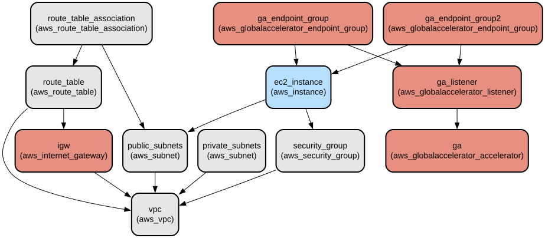

# AWS Global Accelerator Multi-Region Web Server Deployment with Terraform

This project provides an automated infrastructure deployment solution that sets up a globally distributed web application using AWS Global Accelerator. It creates redundant web servers across North Virginia and Mumbai regions with equal load distribution, offering improved availability and reduced latency for global users.

The infrastructure uses Terraform to provision and manage AWS resources including VPCs, EC2 instances running Nginx, and AWS Global Accelerator configuration. The solution implements a multi-region architecture with automatic traffic distribution and client IP preservation, making it ideal for globally distributed web applications requiring high availability and low latency.

## Repository Structure
```
terraform/
├── files/
│   └── user_data.sh          # EC2 instance initialization script for Nginx setup
├── regional-resources/       # Module for region-specific resource creation
│   ├── main.tf              # VPC, subnet, and EC2 instance configurations
│   ├── outputs.tf           # Exposes instance IP and ARN
│   └── variables.tf         # Regional resource configuration variables
├── main.tf                  # Global Accelerator and module instantiation
├── outputs.tf              # Exposes Global Accelerator DNS name
├── provider.tf             # AWS provider configuration for both regions
└── variables.tf            # Availability zone definitions
```

## Usage Instructions
### Prerequisites
- Terraform >= 1.0
- AWS CLI installed and configured with appropriate credentials
- AWS account with permissions to create:
  - VPC and associated networking resources
  - EC2 instances
  - Global Accelerator
  - Security Groups

### Installation

1. Clone the repository:
```bash
git clone <repository-url>
cd terraform
```

2. Initialize Terraform:
```bash
terraform init
```

3. Review and modify variables if needed:
```bash
# Update variables.tf or create a terraform.tfvars file
```

4. Deploy the infrastructure:
```bash
terraform plan
terraform apply
```

### Quick Start

1. After deployment, retrieve the Global Accelerator DNS name:
```bash
terraform output global_accelerator_dns
```

2. Access the web application using the Global Accelerator DNS name:
```bash
curl <global_accelerator_dns>
```

### More Detailed Examples

1. Testing regional failover:
```bash
# Access the application multiple times to see responses from different regions
while true; do curl -s <global_accelerator_dns>; sleep 1; done
```

2. Monitoring endpoint health:
```bash
aws globalaccelerator describe-endpoint-group --endpoint-group-arn <endpoint_group_arn>
```

### Troubleshooting

1. EC2 Instance Connectivity Issues
- Check security group rules
- Verify instance status:
```bash
aws ec2 describe-instance-status --instance-ids <instance-id>
```
- Review instance logs:
```bash
aws ec2 get-console-output --instance-id <instance-id>
```

2. Global Accelerator Issues
- Verify endpoint health:
```bash
aws globalaccelerator describe-accelerator --accelerator-arn <accelerator-arn>
```
- Check DNS propagation:
```bash
dig <global_accelerator_dns>
```

## Data Flow
The system routes traffic through AWS Global Accelerator to the nearest edge location, then forwards requests to the appropriate regional endpoint based on routing policies and health checks.

```ascii
User Request → Global Accelerator → Edge Location → Regional Endpoint → EC2 Instance
     ↑                                                    ↑
     |                                                    |
     └────────────────── DNS Resolution ─────────────────┘
```

Component Interactions:
1. Client requests are directed to Global Accelerator's anycast IP addresses
2. Global Accelerator routes traffic to the nearest edge location
3. Traffic is forwarded to healthy endpoints in either region (50/50 weight)
4. EC2 instances serve the request with region-specific response
5. Health checks monitor endpoint availability
6. Client IP preservation is enabled for accurate logging
7. Security groups control inbound/outbound traffic at instance level

## Infrastructure



### Global Accelerator Resources
- Accelerator: `aws_globalaccelerator_accelerator.ga`
  - Type: IPv4
  - Enabled: true
- Listener: TCP on port 80
- Endpoint Groups:
  - US East (N. Virginia)
  - Asia Pacific (Mumbai)
  - Weight: 50/50 distribution

### Regional Resources (Per Region)
- VPC: 10.0.0.0/16
- Subnets:
  - Public subnets with Internet Gateway
  - Private subnets
- EC2 Instances:
  - Type: t2.micro
  - AMI: Ubuntu 20.04
  - Nginx web server
- Security Group:
  - Allows all inbound/outbound traffic

## Deployment

Prerequisites:
- AWS credentials with appropriate permissions
- Terraform installed locally

Deployment Steps:
1. Configure AWS credentials
2. Initialize Terraform
3. Apply configuration
4. Verify Global Accelerator DNS propagation

Environment Configurations:
- Production: Use terraform.tfvars for environment-specific values
- Monitoring: CloudWatch metrics for Global Accelerator and EC2 instances